# TaKoMi

こんにちは、たこみ/八爪咪です✨IC专业大三在读，毕业即失业

Hi there! I'm takomi. .

### Platforms & Code

### Learning:

### Github stats

### Top langs

按你 commit 数加权 · 20 个公开库（个人公开库 ＋ 各年公开贡献记录发现的组织/他人公开库）

### Contact me

### Tips

All repos with the `-AIGC` suffix are entirely LLM-generated and have not received any code-level review from me.
I’m definitely abusing vibe coding—just look at all these commits.

