# TaKoMi

こんにちは、たこみ/八爪咪です✨IC专业双非大三绝赞逃课中，毕业即失业

Hi there! I'm takomi. .

```
Every repository I own remains my responsibility until archived.
```

### Platforms & Code


### Learning:


### Github stats

[](https://github.com/stats-organization/github-stats-extended)

### Top langs

| 按 commit 数加权 | 无加权（原始语言字节数） |
| :---: | :---: |
| [](https://github.com/stats-organization/github-stats-extended) | [](https://github.com/stats-organization/github-stats-extended) |

同一批 35 个公开库（个人公开非 fork 库 ＋ 你是 contributor 的组织/他人公开库）；左图按你的 commit 数加权，右图按原始语言字节数汇总。

<!-- lang-repo-details:start -->
<details>
<summary>展开仓库统计明细（35 个公开库 · 699 次 commit）</summary>

按加权占比从高到低排列；所有数值与上方卡片使用同一次扫描的数据。

| 仓库 | 你的 commit 数 | 权重 | 语言字节数（B） | 无加权占比 | 加权占比 | 仓库主要语言（前三） |
| :--- | ---: | ---: | ---: | ---: | ---: | :--- |
| [takomitkm/leveldb](https://github.com/takomitkm/leveldb) | 114 | 114 | 1,117,435 | 2.02% | 24.58% | C++ 89.15%、Python 6.08%、C 2.65% |
| [takomitkm/pdd-dailycheck](https://github.com/takomitkm/pdd-dailycheck) | 112 | 112 | 994,429 | 1.80% | 21.49% | Python 61.13%、Shell 38.87% |
| [takomitkm/betterharness](https://github.com/takomitkm/betterharness) | 89 | 89 | 1,080,307 | 1.95% | 18.55% | TypeScript 43.91%、Rust 32.88%、JavaScript 21.63% |
| [vshulcz/deja-vu](https://github.com/vshulcz/deja-vu) | 3 | 3 | 21,839,882 | 39.45% | 12.64% | Go 96.95%、JavaScript 2.13%、Python 0.41% |
| [Nwflower/dsh-chat-import](https://github.com/Nwflower/dsh-chat-import) | 5 | 5 | 4,190,015 | 7.57% | 4.04% | JavaScript 100.00% |
| [takomitkm/takomitkm.github.io](https://github.com/takomitkm/takomitkm.github.io) | 61 | 61 | 320,403 | 0.58% | 3.77% | JavaScript 53.61%、Stylus 26.45%、EJS 14.56% |
| [WCIS-Team/WCIS-FPAI-wiki](https://github.com/WCIS-Team/WCIS-FPAI-wiki) | 30 | 30 | 362,627 | 0.65% | 2.10% | Python 41.32%、HTML 39.18%、Shell 18.08% |
| [Ikalus1988/MisakaNet](https://github.com/Ikalus1988/MisakaNet) | 1 | 1 | 10,800,458 | 19.51% | 2.08% | Python 73.89%、JavaScript 25.50%、Shell 0.38% |
| [WCIS-Team/fmql30tai-sdi-npu-face-recognition](https://github.com/WCIS-Team/fmql30tai-sdi-npu-face-recognition) | 3 | 3 | 3,112,290 | 5.62% | 1.80% | Python 55.03%、C++ 18.27%、Verilog 16.42% |
| [WCIS-Team/ERNIE-4.5-0.3B-PT4icraft430tai](https://github.com/WCIS-Team/ERNIE-4.5-0.3B-PT4icraft430tai) | 19 | 19 | 490,974 | 0.89% | 1.80% | Python 98.77%、Shell 0.98%、Jinja 0.15% |
| [takomitkm/astro-theme-mustom](https://github.com/takomitkm/astro-theme-mustom) | 22 | 22 | 413,851 | 0.75% | 1.76% | Astro 51.37%、TypeScript 40.46%、SCSS 5.78% |
| [Soren-ABT/dsh-knowledge](https://github.com/Soren-ABT/dsh-knowledge) | 2 | 2 | 2,159,269 | 3.90% | 0.83% | TypeScript 94.48%、JavaScript 5.52% |
| [takomitkm/Instrumentality-of-nmud](https://github.com/takomitkm/Instrumentality-of-nmud) | 17 | 17 | 239,840 | 0.43% | 0.79% | Python 68.08%、PowerShell 15.97%、JavaScript 12.47% |
| [WCIS-Team/Qwen2_0.5B_zg3.36.1_axi_demo](https://github.com/WCIS-Team/Qwen2_0.5B_zg3.36.1_axi_demo) | 11 | 11 | 325,630 | 0.59% | 0.69% | Python 65.93%、C++ 32.64%、Shell 1.33% |
| [zilliztech/memsearch](https://github.com/zilliztech/memsearch) | 2 | 2 | 1,429,372 | 2.58% | 0.55% | Python 62.67%、JavaScript 17.52%、TypeScript 10.84% |
| [takomitkm/dialhome](https://github.com/takomitkm/dialhome) | 5 | 5 | 515,655 | 0.93% | 0.50% | Go 65.70%、PowerShell 23.98%、Shell 7.51% |
| [WCIS-Team/tkmFPGA](https://github.com/WCIS-Team/tkmFPGA) | 2 | 2 | 1,188,091 | 2.15% | 0.46% | Verilog 40.53%、C++ 14.26%、SystemVerilog 12.87% |
| [amzxyz/librime-evo](https://github.com/amzxyz/librime-evo) | 1 | 1 | 2,256,039 | 4.07% | 0.44% | C++ 84.84%、C 9.79%、Lua 2.72% |
| [rime/librime](https://github.com/rime/librime) | 1 | 1 | 1,578,966 | 2.85% | 0.30% | C++ 83.00%、C 13.22%、CMake 1.97% |
| [WCIS-Team/WCIS-FPAI](https://github.com/WCIS-Team/WCIS-FPAI) | 83 | 83 | 18,079 | 0.03% | 0.29% | Python 100.00% |
| [WCIS-Team/Qwen3-0.6B4icraft430tai](https://github.com/WCIS-Team/Qwen3-0.6B4icraft430tai) | 9 | 9 | 142,323 | 0.26% | 0.25% | Python 91.32%、PowerShell 5.20%、Jinja 2.93% |
| [hluica/dsh-enhanced-prompt](https://github.com/hluica/dsh-enhanced-prompt) | 3 | 3 | 114,759 | 0.21% | 0.07% | JavaScript 100.00% |
| [rimeinn/rime-moran](https://github.com/rimeinn/rime-moran) | 1 | 1 | 285,508 | 0.52% | 0.06% | Lua 70.19%、Python 25.41%、Shell 2.26% |
| [takomitkm/dotfiles](https://github.com/takomitkm/dotfiles) | 5 | 5 | 50,468 | 0.09% | 0.05% | Python 92.73%、PowerShell 3.86%、Batchfile 3.41% |
| [takomitkm/dsh-service-contract](https://github.com/takomitkm/dsh-service-contract) | 3 | 3 | 62,083 | 0.11% | 0.04% | Python 94.49%、JavaScript 5.51% |
| [takomitkm/lumerical-knowledge-mcp](https://github.com/takomitkm/lumerical-knowledge-mcp) | 0 | 1 | 146,885 | 0.27% | 0.03% | Python 96.72%、PowerShell 3.28% |
| [takomitkm/dsh-bosskey](https://github.com/takomitkm/dsh-bosskey) | 3 | 3 | 45,065 | 0.08% | 0.03% | JavaScript 61.52%、PowerShell 38.48% |
| [takomitkm/upstream-watch](https://github.com/takomitkm/upstream-watch) | 4 | 4 | 29,396 | 0.05% | 0.02% | Python 100.00% |
| [takomitkm/dsh-enter2delworkspace-AIGC](https://github.com/takomitkm/dsh-enter2delworkspace-AIGC) | 1 | 1 | 31,741 | 0.06% | 0.01% | TypeScript 54.08%、PowerShell 28.60%、JavaScript 17.32% |
| [takomitkm/asr-txt-cl](https://github.com/takomitkm/asr-txt-cl) | 0 | 1 | 25,365 | 0.05% | 0.00% | Python 99.40%、Batchfile 0.60% |
| [takomitkm/High-Accuracy-Offline-ASR](https://github.com/takomitkm/High-Accuracy-Offline-ASR) | 16 | 16 | 0 | 0.00% | 0.00% | — |
| [takomitkm/loomos](https://github.com/takomitkm/loomos) | 6 | 6 | 0 | 0.00% | 0.00% | — |
| [WCIS-Team/.github](https://github.com/WCIS-Team/.github) | 6 | 6 | 0 | 0.00% | 0.00% | — |
| [WCIS-Team/HA4FPAI](https://github.com/WCIS-Team/HA4FPAI) | 3 | 3 | 0 | 0.00% | 0.00% | — |
| [WCIS-Team/WCIS-FPAI-repos](https://github.com/WCIS-Team/WCIS-FPAI-repos) | 56 | 56 | 0 | 0.00% | 0.00% | — |
| **合计** | **699** | — | **55,367,205** | **100.00%** | **100.00%** | — |

- 收录范围：个人公开非 fork 仓库，以及 GitHub Contributors API 确认你是 contributor 的外部公开仓库；仅提交 PR、issue 或 review 不足以收录外部库。
- commit 数与权重来自 [GitHub Contributors API](https://docs.github.com/en/rest/repos/repos#list-repository-contributors) 对你账号返回的 contributions，个人库若未查到你的记录则显示 0、权重取 1。
- 候选库通过个人库、各年公开贡献记录和本人 PR 发现，再逐库分页核验 contributor 身份。API 可能缓存数小时；未关联账号的匿名提交无法据此识别。
- 无加权占比 = 本仓库语言字节数 ÷ 全部仓库语言字节数；加权占比 = 本仓库语言字节数 × 权重 ÷ 全部仓库的加权字节数。
- 语言字节数是 GitHub 返回的仓库语言数据（每库最多前 10 种语言），并非你个人编写的字节数；主要语言的百分比以本仓库采集到的语言字节数为分母。
- 表格包含全部采集到的语言；卡片仅展示各自前 20 种语言并重新归一化，因此表格按仓库汇总的占比与卡片按语言展示的占比口径不同。百分比四舍五入后可能不恰好相加为 100%。

</details>
<!-- lang-repo-details:end -->

### Contact me

[](mailto:takomitkm@outlook.com)
[](https://takomitkm.github.io/)
[](https://space.bilibili.com/675978454)
[](https://qm.qq.com/q/)

### Tips

All repos with the `AIGC` topics are entirely LLM-generated and have not received any code-level review or thorough real-world runtime testing. 
I’m definitely abusing vibe coding—just look at all these commits.

----

懒得注册npm等等平台，插件和仓库只在GitHub有，小心重名！

----

# If you’re wondering why I’ve gone quiet, all I can tell you is I’ve burned through all my tokens.
如果你是因为我 fork 了你的项目、没提 PR 才找来的，那你也 fork 我的分支继续做不就好啦～嘻嘻😝
