# TaKoMi

こんにちは、たこみ/八爪咪です✨IC专业大三在读，毕业即失业

Hi there! I'm takomi. .

```
Every repository I own remains my responsibility until archived.
```

### Platforms & Code


### Learning:


### Github stats

[](https://github.com/stats-organization/github-stats-extended)

### Top langs

| 按 commit 数加权 | 无加权（原始语言字节数） |
| :---: | :---: |
| [](https://github.com/stats-organization/github-stats-extended) | [](https://github.com/stats-organization/github-stats-extended) |

同一批 20 个公开库（个人公开非 fork 库 ＋ 你是 contributor 的组织/他人公开库）；左图按你的 commit 数加权，右图按原始语言字节数汇总。

<!-- lang-repo-details:start -->
<details>
<summary>展开仓库统计明细（20 个公开库 · 376 次 commit）</summary>

按加权占比从高到低排列；所有数值与上方卡片使用同一次扫描的数据。

| 仓库 | 你的 commit 数 | 权重 | 语言字节数（B） | 无加权占比 | 加权占比 | 仓库主要语言（前三） |
| :--- | ---: | ---: | ---: | ---: | ---: | :--- |
| [takomitkm/pdd-dailycheck-AIGC](https://github.com/takomitkm/pdd-dailycheck-AIGC) | 78 | 78 | 885,944 | 6.49% | 35.68% | Python 56.37%、Shell 43.63% |
| [WCIS-Team/WCIS-FPAI-repos](https://github.com/WCIS-Team/WCIS-FPAI-repos) | 36 | 36 | 1,059,954 | 7.77% | 19.70% | Verilog 42.67%、C++ 15.97%、Tcl 13.95% |
| [takomitkm/takomitkm.github.io](https://github.com/takomitkm/takomitkm.github.io) | 61 | 61 | 320,403 | 2.35% | 10.09% | JavaScript 53.61%、Stylus 26.45%、EJS 14.56% |
| [Nwflower/dsh-chat-import](https://github.com/Nwflower/dsh-chat-import) | 4 | 4 | 4,063,206 | 29.79% | 8.39% | JavaScript 100.00% |
| [takomitkm/betterharness](https://github.com/takomitkm/betterharness) | 43 | 43 | 311,741 | 2.29% | 6.92% | TypeScript 66.72%、JavaScript 19.53%、Rust 11.81% |
| [takomitkm/astro-theme-mustom](https://github.com/takomitkm/astro-theme-mustom) | 22 | 22 | 413,851 | 3.03% | 4.70% | Astro 51.37%、TypeScript 40.46%、SCSS 5.78% |
| [WCIS-Team/ERNIE-4.5-0.3B-PT4icraft430tai](https://github.com/WCIS-Team/ERNIE-4.5-0.3B-PT4icraft430tai) | 18 | 18 | 490,623 | 3.60% | 4.56% | Python 98.77%、Shell 0.98%、Jinja 0.15% |
| [WCIS-Team/fmql30tai-sdi-npu-face-recognition](https://github.com/WCIS-Team/fmql30tai-sdi-npu-face-recognition) | 2 | 2 | 3,112,290 | 22.81% | 3.21% | Python 55.03%、C++ 18.27%、Verilog 16.42% |
| [takomitkm/Instrumentality-of-nmud-AIGC](https://github.com/takomitkm/Instrumentality-of-nmud-AIGC) | 17 | 17 | 239,840 | 1.76% | 2.11% | Python 68.08%、PowerShell 15.97%、JavaScript 12.47% |
| [WCIS-Team/Qwen2_0.5B_zg3.36.1_axi_demo](https://github.com/WCIS-Team/Qwen2_0.5B_zg3.36.1_axi_demo) | 11 | 11 | 325,630 | 2.39% | 1.85% | Python 65.93%、C++ 32.64%、Shell 1.33% |
| [WCIS-Team/WCIS-FPAI-wiki](https://github.com/WCIS-Team/WCIS-FPAI-wiki) | 8 | 8 | 279,239 | 2.05% | 1.15% | HTML 50.88%、Python 34.80%、Shell 12.48% |
| [WCIS-Team/HA4FPAI](https://github.com/WCIS-Team/HA4FPAI) | 1 | 1 | 1,622,663 | 11.90% | 0.84% | Python 89.04%、Shell 4.54%、HTML 2.85% |
| [WCIS-Team/Qwen3-0.6B4icraft430tai](https://github.com/WCIS-Team/Qwen3-0.6B4icraft430tai) | 8 | 8 | 141,978 | 1.04% | 0.59% | Python 91.30%、PowerShell 5.21%、Jinja 2.94% |
| [rimeinn/rime-moran](https://github.com/rimeinn/rime-moran) | 1 | 1 | 284,411 | 2.08% | 0.15% | Lua 70.46%、Python 25.12%、Shell 2.27% |
| [takomitkm/dsh-bosskey](https://github.com/takomitkm/dsh-bosskey) | 1 | 1 | 32,556 | 0.24% | 0.02% | JavaScript 74.87%、PowerShell 25.13% |
| [takomitkm/dsh-enter2delworkspace-AIGC](https://github.com/takomitkm/dsh-enter2delworkspace-AIGC) | 1 | 1 | 31,741 | 0.23% | 0.02% | TypeScript 54.08%、PowerShell 28.60%、JavaScript 17.32% |
| [takomitkm/asr-txt-cl-AIGC](https://github.com/takomitkm/asr-txt-cl-AIGC) | 0 | 1 | 25,365 | 0.19% | 0.01% | Python 99.40%、Batchfile 0.60% |
| [takomitkm/High-Accuracy-Offline-ASR](https://github.com/takomitkm/High-Accuracy-Offline-ASR) | 16 | 16 | 0 | 0.00% | 0.00% | — |
| [WCIS-Team/.github](https://github.com/WCIS-Team/.github) | 4 | 4 | 0 | 0.00% | 0.00% | — |
| [WCIS-Team/WCIS-FPAI](https://github.com/WCIS-Team/WCIS-FPAI) | 44 | 44 | 0 | 0.00% | 0.00% | — |
| **合计** | **376** | — | **13,641,435** | **100.00%** | **100.00%** | — |

- 收录范围：个人公开非 fork 仓库，以及 GitHub Contributors API 确认你是 contributor 的外部公开仓库；仅提交 PR、issue 或 review 不足以收录外部库。
- commit 数与权重来自 [GitHub Contributors API](https://docs.github.com/en/rest/repos/repos#list-repository-contributors) 对你账号返回的 contributions，个人库若未查到你的记录则显示 0、权重取 1。
- 候选库通过个人库、各年公开贡献记录和本人 PR 发现，再逐库分页核验 contributor 身份。API 可能缓存数小时；未关联账号的匿名提交无法据此识别。
- 无加权占比 = 本仓库语言字节数 ÷ 全部仓库语言字节数；加权占比 = 本仓库语言字节数 × 权重 ÷ 全部仓库的加权字节数。
- 语言字节数是 GitHub 返回的仓库语言数据（每库最多前 10 种语言），并非你个人编写的字节数；主要语言的百分比以本仓库采集到的语言字节数为分母。
- 表格包含全部采集到的语言；卡片仅展示各自前 20 种语言并重新归一化，因此表格按仓库汇总的占比与卡片按语言展示的占比口径不同。百分比四舍五入后可能不恰好相加为 100%。

</details>
<!-- lang-repo-details:end -->

### Contact me

[](mailto:takomitkm@outlook.com)
[](https://takomitkm.github.io/)
[](https://space.bilibili.com/675978454)
[](https://qm.qq.com/q/)

### Tips

All repos with the `-AIGC` suffix are entirely LLM-generated and have not received any code-level review from me.
I’m definitely abusing vibe coding—just look at all these commits.

# If you’re wondering why I’ve gone quiet, all I can tell you is I’ve burned through all my tokens.
