# TaKoMi

Hi! I'm takomi (aka TKM)/八爪咪/たこみ. ✨IC专业双非大三绝赞逃课中

```
Every repo I own remains my responsibility until archived.
```

### Platforms


### GitHub Stats

[](https://github.com/stats-organization/github-stats-extended)

### Top langs

| Weighted by commit counts | Unweighted (raw language bytes) |
| :---: | :---: |
| [](https://github.com/stats-organization/github-stats-extended) | [](https://github.com/stats-organization/github-stats-extended) |

Both cards cover the same 37 public repos (my public non-fork repos + public repos where I'm a contributor); the left one is weighted by commit counts, the right one sums raw language bytes.

<!-- lang-repo-details:start -->
<details>
<summary>Repository details (37 public repos · 811 commits)</summary>

Sorted by weighted share. All numbers come from the same scan as the cards above.

| Repository | My commits | Weight | Language bytes | Unweighted share | Weighted share | Top 3 languages |
| :--- | ---: | ---: | ---: | ---: | ---: | :--- |
| [takomitkm/leveldb](https://github.com/takomitkm/leveldb) | 149 | 149 | 1,119,480 | 1.98% | 26.85% | C++ 89.17%, Python 6.07%, C 2.65% |
| [takomitkm/trustyourharness](https://github.com/takomitkm/trustyourharness) | 100 | 100 | 1,140,922 | 2.02% | 18.36% | TypeScript 41.58%, Rust 35.85%, JavaScript 21.08% |
| [takomitkm/pdd-dailycheck](https://github.com/takomitkm/pdd-dailycheck) | 113 | 113 | 994,429 | 1.76% | 18.09% | Python 61.13%, Shell 38.87% |
| [vshulcz/deja-vu](https://github.com/vshulcz/deja-vu) | 3 | 3 | 22,046,660 | 39.00% | 10.65% | Go 96.98%, JavaScript 2.11%, Python 0.41% |
| [Nwflower/dsh-chat-import](https://github.com/Nwflower/dsh-chat-import) | 8 | 8 | 4,256,236 | 7.53% | 5.48% | JavaScript 100.00% |
| [takomitkm/takomitkm.github.io](https://github.com/takomitkm/takomitkm.github.io) | 62 | 62 | 320,403 | 0.57% | 3.20% | JavaScript 53.61%, Stylus 26.45%, EJS 14.56% |
| [takomitkm/dialhome](https://github.com/takomitkm/dialhome) | 30 | 30 | 596,334 | 1.05% | 2.88% | Go 68.16%, PowerShell 20.74%, Shell 8.67% |
| [WCIS-Team/WCIS-FPAI-wiki](https://github.com/WCIS-Team/WCIS-FPAI-wiki) | 30 | 30 | 362,627 | 0.64% | 1.75% | Python 41.32%, HTML 39.18%, Shell 18.08% |
| [Ikalus1988/MisakaNet](https://github.com/Ikalus1988/MisakaNet) | 1 | 1 | 10,848,368 | 19.19% | 1.75% | Python 73.69%, JavaScript 25.70%, Shell 0.38% |
| [WCIS-Team/fmql30tai-sdi-npu-face-recognition](https://github.com/WCIS-Team/fmql30tai-sdi-npu-face-recognition) | 3 | 3 | 3,112,290 | 5.51% | 1.50% | Python 55.03%, C++ 18.27%, Verilog 16.42% |
| [WCIS-Team/ERNIE-4.5-0.3B-PT4icraft430tai](https://github.com/WCIS-Team/ERNIE-4.5-0.3B-PT4icraft430tai) | 19 | 19 | 490,974 | 0.87% | 1.50% | Python 98.77%, Shell 0.98%, Jinja 0.15% |
| [takomitkm/astro-theme-mustom](https://github.com/takomitkm/astro-theme-mustom) | 22 | 22 | 413,851 | 0.73% | 1.47% | Astro 51.37%, TypeScript 40.46%, SCSS 5.78% |
| [zilliztech/memsearch](https://github.com/zilliztech/memsearch) | 5 | 5 | 1,513,816 | 2.68% | 1.22% | Python 64.19%, JavaScript 17.04%, TypeScript 10.23% |
| [takomitkm/loomos](https://github.com/takomitkm/loomos) | 14 | 14 | 520,782 | 0.92% | 1.17% | Rust 97.95%, Python 1.04%, Shell 1.01% |
| [Soren-ABT/dsh-knowledge](https://github.com/Soren-ABT/dsh-knowledge) | 2 | 2 | 2,187,507 | 3.87% | 0.70% | TypeScript 94.49%, JavaScript 5.51% |
| [takomitkm/Instrumentality-of-nmud](https://github.com/takomitkm/Instrumentality-of-nmud) | 18 | 18 | 239,840 | 0.42% | 0.69% | Python 68.08%, PowerShell 15.97%, JavaScript 12.47% |
| [WCIS-Team/Qwen2_0.5B_zg3.36.1_axi_demo](https://github.com/WCIS-Team/Qwen2_0.5B_zg3.36.1_axi_demo) | 11 | 11 | 325,630 | 0.58% | 0.58% | Python 65.93%, C++ 32.64%, Shell 1.33% |
| [takomitkm/dsh-genshin-launch](https://github.com/takomitkm/dsh-genshin-launch) | 16 | 16 | 163,229 | 0.29% | 0.42% | TypeScript 90.55%, JavaScript 4.04%, Less 3.68% |
| [WCIS-Team/tkmFPGA](https://github.com/WCIS-Team/tkmFPGA) | 2 | 2 | 1,188,091 | 2.10% | 0.38% | Verilog 40.53%, C++ 14.26%, SystemVerilog 12.87% |
| [amzxyz/librime-evo](https://github.com/amzxyz/librime-evo) | 1 | 1 | 2,068,133 | 3.66% | 0.33% | C++ 87.06%, C 10.10%, CMake 1.44% |
| [rime/librime](https://github.com/rime/librime) | 1 | 1 | 1,578,966 | 2.79% | 0.25% | C++ 83.00%, C 13.22%, CMake 1.97% |
| [WCIS-Team/WCIS-FPAI](https://github.com/WCIS-Team/WCIS-FPAI) | 83 | 83 | 18,079 | 0.03% | 0.24% | Python 100.00% |
| [WCIS-Team/Qwen3-0.6B4icraft430tai](https://github.com/WCIS-Team/Qwen3-0.6B4icraft430tai) | 9 | 9 | 142,323 | 0.25% | 0.21% | Python 91.32%, PowerShell 5.20%, Jinja 2.93% |
| [takomitkm/dsh-service-contract](https://github.com/takomitkm/dsh-service-contract) | 6 | 6 | 88,331 | 0.16% | 0.09% | Python 96.12%, JavaScript 3.88% |
| [hluica/dsh-enhanced-prompt](https://github.com/hluica/dsh-enhanced-prompt) | 3 | 3 | 114,759 | 0.20% | 0.06% | JavaScript 100.00% |
| [takomitkm/dotfiles](https://github.com/takomitkm/dotfiles) | 6 | 6 | 50,468 | 0.09% | 0.05% | Python 92.73%, PowerShell 3.86%, Batchfile 3.41% |
| [rimeinn/rime-moran](https://github.com/rimeinn/rime-moran) | 1 | 1 | 285,508 | 0.51% | 0.05% | Lua 70.19%, Python 25.41%, Shell 2.26% |
| [takomitkm/lumerical-knowledge-mcp](https://github.com/takomitkm/lumerical-knowledge-mcp) | 0 | 1 | 146,885 | 0.26% | 0.02% | Python 96.72%, PowerShell 3.28% |
| [takomitkm/dsh-bosskey](https://github.com/takomitkm/dsh-bosskey) | 3 | 3 | 45,065 | 0.08% | 0.02% | JavaScript 61.52%, PowerShell 38.48% |
| [takomitkm/upstream-watch](https://github.com/takomitkm/upstream-watch) | 4 | 4 | 29,396 | 0.05% | 0.02% | Python 100.00% |
| [takomitkm/dsh-enter2delworkspace-AIGC](https://github.com/takomitkm/dsh-enter2delworkspace-AIGC) | 2 | 2 | 31,741 | 0.06% | 0.01% | TypeScript 54.08%, PowerShell 28.60%, JavaScript 17.32% |
| [WCIS-Team/mddocs-path-i18n](https://github.com/WCIS-Team/mddocs-path-i18n) | 1 | 1 | 58,730 | 0.10% | 0.01% | Python 100.00% |
| [takomitkm/asr-txt-cl](https://github.com/takomitkm/asr-txt-cl) | 1 | 1 | 25,365 | 0.04% | 0.00% | Python 99.40%, Batchfile 0.60% |
| [takomitkm/High-Accuracy-Offline-ASR](https://github.com/takomitkm/High-Accuracy-Offline-ASR) | 17 | 17 | 0 | 0.00% | 0.00% | — |
| [WCIS-Team/.github](https://github.com/WCIS-Team/.github) | 6 | 6 | 0 | 0.00% | 0.00% | — |
| [WCIS-Team/HA4FPAI](https://github.com/WCIS-Team/HA4FPAI) | 3 | 3 | 0 | 0.00% | 0.00% | — |
| [WCIS-Team/WCIS-FPAI-repos](https://github.com/WCIS-Team/WCIS-FPAI-repos) | 56 | 56 | 0 | 0.00% | 0.00% | — |
| **Total** | **811** | — | **56,525,218** | **100.00%** | **100.00%** | — |

- Scope: my public non-fork repos, plus public repos where the GitHub Contributors API confirms I'm a contributor; PRs, issues or reviews alone don't qualify an external repo.
- Commit counts and weights come from the [GitHub Contributors API](https://docs.github.com/en/rest/repos/repos#list-repository-contributors); own repos where it finds no record show 0 commits and get weight 1.
- Candidate repos come from my own repos, yearly public contributions and my authored PRs, then get verified page by page against the contributors endpoint. The API may cache for hours; anonymous commits with no linked account can't be attributed.
- Unweighted share = repo language bytes ÷ total language bytes; weighted share = repo language bytes × weight ÷ total weighted bytes.
- Language bytes are GitHub's per-repo language data (top 10 languages per repo), not bytes I personally wrote; the top-language percentages use that repo's collected bytes as the denominator.
- The table lists all collected languages; each card shows only its top 20 and renormalizes, so per-repo shares here and per-language shares on the cards differ by design. Rounded percentages may not sum to exactly 100%.

</details>
<!-- lang-repo-details:end -->

### Contact me

[](mailto:takomitkm@outlook.com)
[](https://takomitkm.github.io/)
[](https://space.bilibili.com/675978454)
[](https://qm.qq.com/q/)

### Tips

#### Warning
- All repositories tagged with the `aigc` topic have not been reviewed at the code level or thoroughly tested in real-world environments.
- I’m definitely abusing vibe coding—just look at all these commits.

#### For users
- I can't be bothered to register on npm and other platforms, so my plugins and repos r only available on GitHub. Watch out for the same name!

#### For developers
- If you’re wondering why I’ve gone quiet, all I can tell you is I’ve burned through all my tokens.
- If you're here because I forked your project without opening a PR, why not just fork my branch and carry on? Hehe 😝

----
### My licensing preferences

- **End-user products:** [GPL-3.0](https://www.gnu.org/licenses/gpl-3.0.en.html) / [AGPL-3.0](https://www.gnu.org/licenses/agpl-3.0.en.html).
- **Middleware and foundational components:** [Apache-2.0](https://www.apache.org/licenses/LICENSE-2.0) / [LGPL-3.0](https://www.gnu.org/licenses/lgpl-3.0.en.html) / [MPL-2.0](https://www.mozilla.org/en-US/MPL/2.0/).
- **Scripts and small AIGC projects:** [0BSD](https://opensource.org/license/0bsd).
- **Visual designs and creative assets:** [CC BY 4.0](https://creativecommons.org/licenses/by/4.0/).
